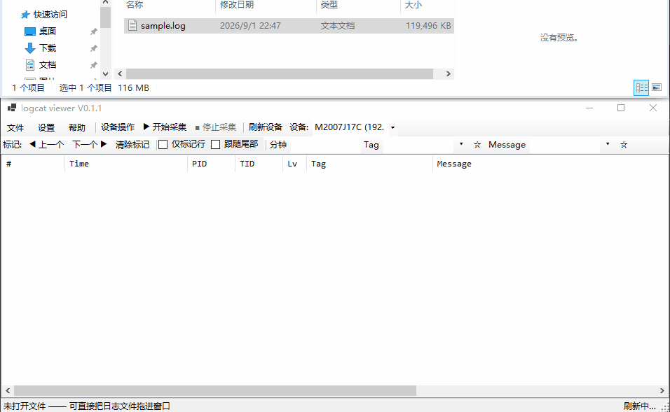

# logcat viewer

[](logcat.csproj)
[](LICENSE)
[](#requirements)
[](https://github.com/daitouniao/logcat-viewer/actions/workflows/ci.yml)
[](docs/TESTING.md)
[](docs/TESTING.md)

A Windows desktop pair for Android logs (`logcat`). Built with WinForms on .NET 10, it ships **two exes from one repo**: `logcat.exe`, the log viewer, opens and scrolls through **tens of millions of log lines** smoothly using memory-mapped files and a columnar index and drives live capture over ADB; `logcat-andtools.exe`, the Android toolbox, gathers the device tools — screenshots, screen recording, two-pane file transfer, APK install/uninstall and a command window — behind one tabbed window. The viewer launches the toolbox from its "Device operations" entry, and each runs standalone: you can use the toolbox without ever opening the viewer.

**English** | [简体中文](README.zh-CN.md)

Repositories:

- Gitee (primary): <https://gitee.com/dyugao/logcat-viewer>
- GitHub (mirror): <https://github.com/daitouniao/logcat-viewer>
- GitCode (mirror): <https://gitcode.com/gcw_WDXl5paK/logcat-viewer>

> Mirrors (GitHub / GitCode) lag behind the primary — pushes are synced there with a delay, so the latest commits and releases always land on Gitee first.

> Current version **V0.1.8-pre1**. The single source of truth is `<Version>` in [Directory.Build.props](Directory.Build.props) — both exes and the shared library inherit it, and the window title, the about dialog and the exe's file properties all read from it.
>
> The UI speaks **both Chinese and English** and switches at runtime — `Help → Language`, no restart. First launch follows your system locale; the choice is remembered in `language.json`.



## Log viewing

Most logcat viewers choke on large captures. This one keeps the text on disk (mmap) and holds only the fixed-width columns in memory. Opening scans the file in chunks (small first chunk, large steady-state chunks, chunk ends aligned to line boundaries) and **publishes rows progressively** — you see logs on screen while the index is still building. Cost scales linearly with file size (the progress bar can be cancelled, which clears the load): a 1 GB file takes on the order of ten seconds (machine-dependent) and larger files scale up accordingly — it is not an instant open. While loading, filter changes take effect immediately on the already-published prefix; after that, scrolling reads rows from the mapping on demand — the file is never pulled into RAM, and the frame rate stays steady.

| Capability                     | How it works                                                                                             |
| ------------------------------ | -------------------------------------------------------------------------------------------------------- |
| **Huge files, low memory**     | Memory-mapped text + columnar index, chunked progressive loading (rows appear while scanning), cancellable progress bar |
| **Virtual list**               | Only visible rows are rendered, so scrolling stays smooth at 10M+ rows                                   |
| **Six formats auto-detected**  | `threadtime` / `time` / `long` / `brief` / `tag` / `ymd`, via a byte-level fast path with regex fallback |
| **Level colours**              | V/D/I/W/E/F/A colour-coded                                                                               |
| **Full record view**           | Double-click a row (`Enter`) to see the untruncated original text                                        |
| **Incremental reload**         | `F5` re-reads only the appended tail, with line-boundary alignment across batch edges                    |
| **Filter while loading**       | Filter edits during a load apply immediately: the published prefix is re-filtered in full, later chunks go through incremental filtering |

## Filtering

- **Level**: freely toggle V/D/I/W/E/F/A, with select-all / clear-all shortcuts
- **Tag / Message**: `or` / `and` combination, case-sensitivity, exclude mode
- **PID / TID**: multiple values space-separated, excludable
- **Minute**: filter by the timestamp's minute value, e.g. `05 20`
- **Marked rows only**
- **Auto-apply**: refreshes 400 ms after you stop typing; `Ctrl+Enter` applies manually
- **Detached filter window**: the filter panel lives in a non-modal window that floats above the main window, so the entire main area is left to the log list. Closing it only collapses it — your filter conditions survive. Reopen via `Ctrl+F`
- **Saved filters**: separate favourites for Tag and Message, up to 60 each, persisted

## Marking and export

- Press `M` (or double-click the line-number column) to mark/unmark; `F2` / `Shift+F2` jump between marks
- Right-click to filter directly by that tag / PID / TID / minute
- Export the current result, or only marked rows (one physical log line per record)
- Copy as raw text or as tab-separated table rows

## ADB device features

Toolbar provides live capture, device operations, and save:

| Feature              | Description                                                                                                                                                                                                                                                                            |
| -------------------- | -------------------------------------------------------------------------------------------------------------------------------------------------------------------------------------------------------------------------------------------------------------------------------------- |
| Refresh devices      | Enumerates online devices; hot-plug is monitored automatically; if the adb server is not running it is started first, and a manual-action hint is shown instead of "no devices" when adb itself is unavailable                                                                                                                         |
| Start / stop capture | Streams `logcat` to a temp file and syncs incrementally into the list, following the tail. Capture and filtering/export are mutually excluded on the document (serialised access), and pure tail appends only re-filter the new rows — per-second cost drops from O(total) to O(added) |
| Save log             | Saves the current capture as a `.log` file                                                                                                                                                                                                                                             |
| Device operations    | Launches the standalone **Android toolbox** (`logcat-andtools.exe`, expected next to this exe); if the toolbox is already running it is brought to the front instead, and a missing toolbox disables the entry with a hover hint rather than an error                                  |

## Device operations window

The Android toolbox (`logcat-andtools.exe`) hosts screenshots, screen recording, file browsing, APK install/uninstall and the command window in one singleton tabbed window; it has its own device dropdown, runs standalone, and keeps a single instance per Windows session (launching it again brings the existing window to the front). Tabs are created lazily on first open and keep their state; switching devices rebuilds device-bound tabs automatically; closing the window cleans up (stops recording, cancels command tasks, writes options back).

### Screenshot / Screen record / File browser

**Screenshot & record**: preview and save, or pull the recording to your PC.

**File browser**: a two-pane device ↔ PC file manager with:
- Transfer, refresh, directory favourites, and rename
- Restricted directories such as `/data/data` need root (toolbar run-as button acts as a mode drop-down)
- Transfers tolerate files being in use
- Drag-and-drop preserves relative structure
- `sync` is issued after upload so data survives an unplug

### Install / uninstall APK

- **Two install channels**
  - `adb install` with optional `-r` (keep data, on by default), `-d` (allow downgrade), `-g` (grant all permissions), `-t` (allow test packages)
  - `pm install` as a fallback when `adb install` is disabled — pushes the APK to a device temp directory (default `/data/local/tmp`) and cleans up afterwards
- **Two uninstall channels**: `adb uninstall` or `pm uninstall`, with optional `-k` (keep data and cache); the `pm` channel can run as root via `su -c`, which uninstalling system apps usually requires
- **Installed app list**: pulls third-party apps on connect (name / package / APK path), double-click or `Enter` to uninstall
- **Favourites** for local APK paths and package names; options are remembered between sessions

### Command window

Collect the commands you keep retyping, organise them into categories, and re-run them on the selected device (`Ctrl+Shift+C`).

- **Two execution channels**
  - *Device shell* — via `adb shell`; when root is ticked it is wrapped as `su -c '...'` with POSIX single-quote escaping
  - *Local adb* — calls `adb.exe` directly for subcommands like `install` / `reboot` / `push`, automatically appending `-s <serial>`, and reports the exit code
- **Categories**: 112 built-in commands across 5 categories (`shell`, `dumpsys`, apps & packages, logs & exceptions, `adb`); create / rename / delete your own
- **Favourites and history**: up to 300 favourites deduplicated by command text + channel; execution history keeps the last 120 with usage counts
- **Placeholder parameters**: any `{name}` in a command (letters/digits/`_`/`-`) is prompted for before execution, and the last value is remembered. The built-in library uses `{pkg}`, `{pid}`, `{file}`, `{path}`, `{activity}`, `{url}`, `{tag}`, `{ip}`, `{apk}`, `{name}`; `{pkg}` also falls back to your run-as favourites as the default
- **Streaming output**: line-by-line echo with line count and elapsed time; long-running commands like `logcat` can be stopped or time out (default 30 s, 0 = unlimited)
- **No accidental runs**: double-click or `Enter` only fills the input box; you still have to press Execute

## User experience

### Window position memory (multi-monitor)

The main window's position, size and state are saved on close and restored on next launch — including which monitor it was on, for both horizontally and vertically arranged displays. If that monitor is no longer connected, the saved geometry fails validation and the app falls back to the default layout instead of restoring off-screen.

Verification: `Log\startup.log` (next to the exe; the toolbox writes `Log\startup-andtools.log`) records the screen topology, the coordinates read, the validation result, the actual landing position, and the coordinates written on close.

### High-DPI support

Every hand-written dialog under `Forms/` declares `AutoScaleMode.Dpi` and scales with the system DPI, so button text is no longer clipped on high-scaling displays. The app font follows the UI language — Microsoft YaHei UI for Chinese, which fixes the missing-CJK-glyph problem that made Chinese text render as clipped glyphs under GDI font fallback at high DPI; Segoe UI for English.

Multi-monitor with different scaling (e.g. primary 150%, secondary 100%):
- Filter window height auto-adjusts to content after showing
- Toolbar row heights use AutoSize instead of fixed heights
- Dropdown widths clamp to minimum to keep buttons visible
- DpiFix dynamically expands TableLayoutPanel rows and fixed-height button bars that would otherwise overflow

Verification: DPI measurements and fallback actions are logged to `Log\startup.log` (next to the exe) `[DPI]` section.

### Bilingual UI (Chinese / English)

The entire UI is available in both languages and switches **at runtime** — no restart.

- **Switching**: `Help → Language → 简体中文 / English`; the choice is persisted to `language.json`
- **Default**: first launch follows the system locale (`CultureInfo.CurrentUICulture`); a corrupt or missing setting falls back to it
- **What gets re-measured on switch**: not just text. The whole UI is built in code (`frmMain.Designer.cs` is 37 lines), so switching re-walks every open form and applies the target language's font — Microsoft YaHei UI for Chinese (Segoe UI has no CJK glyphs and clips them at high DPI), Segoe UI for English — then re-measures fixed-width buttons and absolutely-positioned dialogs, which are ~30–50% wider in English
- **Scope**: per-area translation tables under `logcat.UiCore/Services/LocTable.*.cs`, plus per-language fixed widths for columns and dialogs

A language layout audit walks the control tree in both languages at minimum / default / half width and asserts **zero clipped labels**.

## Requirements

**To run a published build — Windows is all you need.** Every release ships two builds; pick
the one that fits your machine:

| Build                              | Target machine                                                                                     | Size    |
| ---------------------------------- | -------------------------------------------------------------------------------------------------- | ------- |
| `logcat-V<version>-win-x64.zip`    | **Windows only** — unzip and run, nothing to install                                               | ~120 MB |
| `logcat-V<version>-win-x64-fd.zip` | Needs [.NET 10 Desktop Runtime](https://dotnet.microsoft.com/download/dotnet/10.0) installed first | ~1.8 MB |

Not sure? Take the self-contained one — it is the larger download but zero setup.

- **Windows x64** (10 or later)
- **`adb`** on your `PATH` — only for the device features (live capture, screenshots, file
  transfer, APK install). The app starts the ADB server itself if it isn't running. Everything
  else (opening and filtering log files) works without it.

**To build from source:** .NET 10 SDK (`net10.0-windows`, WinForms).

## Build and run

```powershell
dotnet build logcat.slnx -c Release        # build (both exes)
dotnet run --project .                     # run the viewer
dotnet publish logcat.csproj -c Release -o publish\fd
dotnet publish logcat.AndTools\logcat.AndTools.csproj -c Release -o publish\fd
                                           # publish (framework-dependent; run BOTH, same output dir; self-contained see docs/BUILDING.md)
```

You can also open `logcat.slnx` / `logcat.csproj` directly in Visual Studio.

> Pre-built binaries are shipped alongside every release. Download them from the Release pages:
> - Gitee (primary): <https://gitee.com/dyugao/logcat-viewer/releases>
> - GitHub (mirror): <https://github.com/daitouniao/logcat-viewer/releases>
> - GitCode (mirror): <https://gitcode.com/gcw_WDXl5paK/logcat-viewer/releases>
>
> Mirrors sync with a delay — if a release is not there yet, get it from Gitee.
>
> Build from source only when you need a custom configuration (trim dependencies, change default paths, sign the binary, etc.).

## Tests

Log parsing, the columnar index (including incremental append and line-boundary alignment), the filter
engine, the persistence stores and the localization tables are covered by xUnit tests. The UI and
device/system-integration layers are intentionally excluded from the coverage scope.

```powershell
# run the suite
dotnet test tests/logcat.Tests/logcat.Tests.csproj

# run with coverage (coverlet -> cobertura), then render a readable report
dotnet test tests/logcat.Tests/logcat.Tests.csproj --collect:"XPlat Code Coverage" --settings tests/logcat.Tests/coverlet.runsettings
python tests/coverage-report.py     # writes tests/coverage-report.html
```

Current status: **791 tests, all passing**; **97.31%** line coverage (3,828 / 3,934 lines), **88.65%** branch coverage.

The scope is defined in `tests/logcat.Tests/coverlet.runsettings` and excludes two groups:

- **UI layer** — `Forms` / `Controls` / `frmMain` / `Program`, plus `DpiFix` / `DpiDiag` / `Loc`: WinForms construction and layout depend on a message pump and STA threads, so unit-testing them is costly and low-value. `Loc` is excluded for the same reason as `DpiFix` — half of it is control-tree walking, font swapping and pixel measurement, which only mean something against a real form. Its sibling `LocTable.*` (pure data translation tables) is **kept in scope** and is guarded by 30 `LocTableTests` cases, including source scans that catch untranslated strings.
- **Device / system integration layer** — `AdbManager` (needs a real adb server and device), `LogcatStream` (device stream), `ClipboardHelper` (Windows clipboard), `StartupLog` (writes into the user profile).

> In a restricted sandbox (some IDE-managed terminals) the test host may be denied writes to `%TEMP%`, which
> fails many tests. Point the temp directory into the workspace instead:
> `TMP=<dir inside the repo> TEMP=<same> dotnet test ...`.

## Keyboard shortcuts

| Shortcut          | Action                                                 |
| ----------------- | ------------------------------------------------------ |
| `Ctrl+O`          | Open a log file                                        |
| `F5`              | Reload (incremental; skipped if the file is unchanged) |
| `Ctrl+E`          | Export current result                                  |
| `Ctrl+Enter`      | Apply filter                                           |
| `Ctrl+F`          | Open the filter window and focus the Message box       |
| `Ctrl+C`          | Copy selected rows                                     |
| `Ctrl+Shift+C`    | Open the command window                                |
| `F2` / `Shift+F2` | Previous / next mark                                   |
| `F3` / `Shift+F3` | Find next / previous in results                        |
| `M`               | Mark the current row                                   |
| `Enter`           | View the full record for the current row               |
| `Esc`             | Stop the current task and clear the selection          |
| `Ctrl+Q`          | Quit                                                   |

You can also drag a log file straight onto the window.

## Filter syntax

- Separate multiple keywords with spaces: `crash anr`
- Wrap phrases in double quotes: `"null pointer"`
- The `or` / `and` drop-down decides how multiple terms combine (both Tag and Message default to `or`)
- The term boxes are colour-coded: **background** shows the match relation (`or` blue / `and` orange), **text colour** turns dark red when case-sensitivity is on. An empty box stays uncoloured
- The toolbar and the filter dialog mirror each other: type in either one and both update
- Tick *exclude* to drop matches

## Project structure

Three projects in one solution (`logcat.slnx`): the viewer exe, the toolbox exe, and the shared library both exes are built on.

```
logcat.slnx             Solution (logcat exe + logcat.UiCore library + logcat.AndTools exe)
Directory.Build.props   <Version> single source (inherited by all three projects)
logcat.UiCore/          Shared library: everything both exes draw on (no exe of its own)
  Controls/
    FilePane.cs           File pane base class (navigation, list rendering, favourites, rename, drag-drop)
    DeviceFilePane.cs     Device-side file pane
    LocalFilePane.cs      Local-side file pane
  Forms/
    DeviceOpsDialog.cs    Device operations: screenshot / record / file browser / APK / command merged into tabs
    FileBrowserDialog.cs  Device ↔ local two-pane file manager (file browser tab in DeviceOpsDialog)
    ApkInstallDialog.cs   APK install (adb install / pm install, path favourites)
    ApkUninstallDialog.cs APK uninstall (installed app list, package name favourites)
    CommandDialog.cs      Command window (categories, favourites, history, execution, output)
    CommandEditDialog.cs  New / edit favourite command
    ScreenShotDialog.cs   Screenshot tab (in DeviceOpsDialog)
    ScreenRecordDialog.cs Screen record tab (in DeviceOpsDialog)
    RunAsDialog.cs        Run-as package name selector
    SimpleInputBox.cs     Simple input dialog
  Models/                 DeviceInfo / FileEntry / FavoriteDir / CommandEntry / DeviceLastDir …
  Services/
    AdbManager.cs         ADB wrapper (device enumeration, shell, streaming, local adb, screenshot, push/pull)
    DeviceSelector.cs     Device selection logic shared by both exes (refresh, self-heal, current serial, change events)
    Loc.cs + LocTable.*   Localization runtime + per-area translation tables (Common / MainUi / DeviceUi / FileUi / ApkUi / CommandUi / FilterUi / RuntimeMsg …)
    SingleInstance.cs     Single-instance guard with injectable mutex name (+ andtools wake event constants)
    StartupLog.cs         Startup diagnostic log (exe-relative `Log\startup.log`, per-session file name)
    DpiDiag.cs / DpiFix.cs High-DPI diagnostics and layout fallback
    FavoritesStore.cs     Favourites persistence (directories, run-as packages, APK paths, app packages, tag/message filter conditions)
    CommandStore.cs       Command categories / favourites / history persistence + built-in command library
    AndToolsSettings.cs   Toolbox-side settings (`andtools.json`: last paths, column widths, APK options, toolbox window geometry)
    LanguageSettings.cs   UI language setting (`language.json`, shared by both exes)
    SettingsIO.cs + ConfigMigration.cs + LegacySettings.cs
                          Versioned JSON IO (atomic write) + one-time split migration from the pre-0.1.7 single `settings.json`
    AppInfo.cs            Product name and version (reads Assembly InformationalVersion)
logcat.AndTools/         Android toolbox exe (`logcat-andtools.exe`)
  Program.cs             Entry point: own single-instance mutex + wake event, split migration, wake listener
  AndToolsMainForm.cs    Main window (DeviceOpsDialog container promoted to an app window: title, device dropdown, geometry)
  AndToolsWindowGeometry.cs  Toolbox window geometry save/restore (andtools.json)
  AndToolsMigration.cs   Toolbox-side migration branch (writes andtools.json + language.json from legacy settings)
  WakeUp.cs              Second-launch wake: foreground request, taskbar-flash fallback
Program.cs               Viewer entry point (logcat.exe)
frmMain.cs               Viewer main window: layout, dual toolbars, filter panel, ADB entry points, shortcuts
Controls/
  LogListView.cs         Virtual-mode log list (columns, level colours, marks, view snapshots)
  LoadPublishBuffer.cs   Chunked progressive-load publish buffer
Forms/
  FilterDialog.cs        Detached filter window (hosts the main window's filter panel)
  CrashSummaryForm.cs    Crash summary window (☠ rows, one-glance grouping, click to jump)
  RecordDialog.cs        Single record detail pop-up
  FileProxyDialog.cs     File proxy monitor window
Models/
  FilterSpec.cs          Filter conditions
  CrashEvent.cs          Crash event detected at index time (type / package / line / timestamp)
Services/
  LogDocument.cs         Columnar index document (mmap + columnar index, incremental reload)
  LogParser.cs           Line parser (six formats + new-record shape detection)
  CrashExtractor.cs      Crash / ANR / native fault signal detection bound to the index scan
  CrashAggregator.cs     Groups crash events by type and package for the summary window
  FilterEngine.cs        Filter engine (pre-filter → message match (block scan for large docs, per-row for incremental) → export)
  LogcatStream.cs        Live logcat capture stream
  TextProbe.cs           Encoding/text probes for loading
  LogcatSettings.cs      Viewer-side settings (`settings.json`: window geometry, display options, file proxy)
  FileProxyService.cs + FileProxyClient.cs + FileProxyMode.cs + ProxyChannel.cs + FileProxyException.cs
                          Local file proxy pipeline (named pipe, spool dirs, launched process management)
  AndToolsLauncher.cs    Toolbox launcher (File.Exists probe → disable entry with hint, or Process.Start)
app.ico                  Application icon (referenced in both exe csproj ApplicationIcon)
tests/
  coverage-report.py     Coverage report generation (coverlet cobertura XML → readable HTML)
  logcat.Tests/          xUnit test project (825 tests: log parsing / columnar index / filter engine / crash extraction / persistence / localization / settings split / device selection)
    coverlet.runsettings Coverage scope (Include / Exclude rules)
docs/
  BUILDING.md            How to build and publish — the per-package `dotnet publish` pairs, artifact verification, smoke checklist, pitfall table
  TESTING.md             How to run the suite and produce coverage (single entry point)
  UT-AUDIT.md            Mutation-testing audit — where the tests actually bite
  memory/                Cross-change lessons and working discipline — the pitfalls worth not repeating
  FEATURES.md            Feature plan — what is being built next and what is deliberately not built
  archive/               Archived snapshots (verified bug reports / completed designs / the retired tracker)
  images/main.gif        The demo animation at the top of this file
Note: IMPLEMENTATION-TRACKER.md (design ↔ code ↔ bugfix status) was retired on 2026-10-22 — upkeep cost too high; its snapshot sits in `docs/archive/` and is no longer maintained.
LICENSE                 Apache-2.0 full text
THIRD-PARTY-NOTICES.md  Third-party licences
DISCLAIMER.md           Disclaimer full text
```

## Documentation

| Document                                         | When to read it                                                                                                         |
| ------------------------------------------------ | ----------------------------------------------------------------------------------------------------------------------- |
| [docs/BUILDING.md](docs/BUILDING.md)             | Building or publishing — the per-package `dotnet publish` pairs (both exes), artifact verification, smoke checklist, pitfall table |
| [docs/TESTING.md](docs/TESTING.md)               | Running the suite or producing coverage — includes the workaround for `dotnet test` failing inside a restricted sandbox |
| [docs/UT-AUDIT.md](docs/UT-AUDIT.md)             | Whether the tests actually bite — the mutation-testing audit                                                            |
| [docs/memory/](docs/memory/)                     | Cross-change experience — the pitfalls and discipline that came out of real operations                                   |
| [THIRD-PARTY-NOTICES.md](THIRD-PARTY-NOTICES.md) | Dependencies and licences — per-package versions, licences, copyright lines and distribution checklist                  |
| [DISCLAIMER.md](DISCLAIMER.md)                   | The full terms to read before using the tool                                                                            |

## Data storage

- Since V0.1.7, user settings are split across three JSON files next to the exes (a legacy single `settings.json` from 0.1.x or earlier is split automatically on first launch of either exe):
  - `settings.json` — viewer-side: window position/size/state, auto-apply, font size, file proxy
  - `andtools.json` — toolbox-side: last browse paths, file-browser column widths, install/uninstall options, toolbox window geometry
  - `language.json` — the **UI language**, shared by both exes (change it in one, the other follows on next launch)
- Favourites (device/local directories with aliases, run-as packages, APK paths, app packages, tag/message filter conditions; up to 60 per list, most-recent first) go to `favorites.json` (next to the exe)
- Command categories, favourites, history, and placeholder values go to `commands.json` (next to the exe, first open writes the built-in library)
- Live capture writes to `logcat_live_*.log` in the system temp directory, cleaned up on window close
- Multi-monitor window geometry is validated on each launch; if the saved monitor is no longer connected, the app falls back to default layout instead of restoring off-screen

## License

[Apache License 2.0](LICENSE). It was chosen to match the licences of the dependencies and toolchain: the only non-Microsoft dependency is the Apache-2.0 ADB client library and everything else is MIT, so Apache-2.0 covers the whole dependency tree without conflict and adds the patent grant. Free to use, modify and distribute under the Apache-2.0 terms, including commercially.

> The source was produced with AI assistance and is not attributed to a named individual author; copyright is declared collectively as `logcat viewer contributors`. To put your own attribution in place, change two places: the `Copyright` line in the `LICENSE` appendix and `<Copyright>` in `logcat.csproj`.

### Licence compatibility

| Used                                                                       | Licence                                                                            | Relationship to this project                                                                                                         |
| -------------------------------------------------------------------------- | ---------------------------------------------------------------------------------- | ------------------------------------------------------------------------------------------------------------------------------------ |
| AdvancedSharpAdbClient 3.6.16                                              | Apache-2.0                                                                         | The only non-Microsoft NuGet library; its DLL ships with the build → Apache-2.0 keeps things simplest                                |
| Microsoft.Extensions.* 10.0.11 (Logging and its dependencies, 13 packages) | MIT                                                                                | MIT code can be incorporated into an Apache-2.0 project without restriction, keeping its copyright notice                            |
| .NET SDK 10.0.400 / C# compiler / WinForms                                 | Source MIT; installed binaries under the Microsoft Software Licence — .NET Library | Build toolchain and runtime; the terms permit building and distributing applications for free                                        |
| adb.exe (Android platform-tools)                                           | Apache-2.0                                                                         | An external program in the user's environment — not bundled or modified; if you redistribute platform-tools, keep its LICENSE/NOTICE |

### Details and compliance

- The full inventory (package names, versions, licence identifiers, copyright lines, transitive dependencies, distribution checklist) is in [THIRD-PARTY-NOTICES.md](THIRD-PARTY-NOTICES.md).
- `dotnet build` / `dotnet publish` copy `README.md` (English), `README.zh-CN.md` (Chinese), `LICENSE`, `THIRD-PARTY-NOTICES.md` and `DISCLAIMER.md` into the output directory, so every binary release carries its own notices.
- Assembly copyright information is written into the exe's *Properties → Details*.

### Contributions are licensed as Apache-2.0

Per Apache-2.0 §5, contributions submitted to this repository are licensed under Apache-2.0 by default and need no separate declaration. When you modify a source file, note the modification there as required by §4(b).

## Disclaimer

See [DISCLAIMER.md](DISCLAIMER.md) for the full terms. Using this software means you have read, understood and agreed to all of them; **if you disagree with any of them, stop using it and delete it immediately.** In short:

- **Device operations are at your own risk** — screenshots, screen recording, file transfer, APK install/uninstall and `adb shell` / root commands act directly on your device; confirm what each command does. Loss of data, system instability or device damage caused by a mistake is borne by you, the operator.
- **root and restricted directories** — accessing `/data/data` and similar requires root or run-as, and may damage app data or affect your warranty
- **Lawful use only** — only on devices and data you are authorised to access
- **Logs contain sensitive data** — logcat output often includes credentials, tokens and location data; sanitise before sharing
- **Not an official tool** — not affiliated with Google, Android or the ADB team
