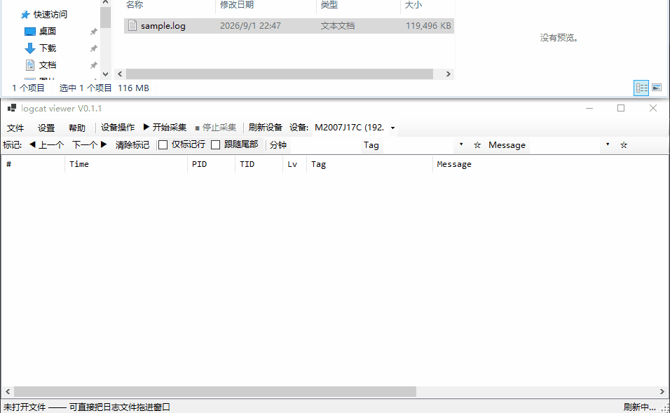

# logcat viewer

[](logcat-viewer/logcat.csproj)
[](LICENSE)
[](#环境要求)
[](https://github.com/daitouniao/logcat-viewer/actions/workflows/ci.yml)
[](docs/TESTING.md)
[](docs/TESTING.md)

Windows 桌面端 Android 日志（logcat）工具组。基于 WinForms，一个仓库出**两个 exe**：`logcat.exe` 日志查看器——内存映射文件 + 列式索引，可直接打开并流畅浏览千万行级别的日志文件，支持 ADB 实时采集；`logcat-andtools.exe` 安卓工具箱——截图、录屏、文件互传、APK 安装/卸载与命令窗口合并为一个页签式窗口，可独立使用。查看器的「设备操作」入口一键拉起工具箱，两者也可各开各的。

[English](README.md) | **简体中文**

项目地址：

- Gitee（主仓库）：<https://gitee.com/dyugao/logcat-viewer>
- GitHub（镜像）：<https://github.com/daitouniao/logcat-viewer>
- GitCode（镜像）：<https://gitcode.com/gcw_WDXl5paK/logcat-viewer>

> 镜像仓库（GitHub / GitCode）的更新会稍慢于主仓库——提交与 Release 同步到镜像有延迟，最新内容以 Gitee 为准。

> 当前版本 **V0.1.9-pre1**。版本号以 [Directory.Build.props](Directory.Build.props) 的 `<Version>` 为唯一来源，两个 exe 与共享库一并继承；程序标题、关于对话框与 exe 文件属性会自动同步。
>
> 界面**中英双语**，`帮助 → 语言` 运行时即时切换，选择记在 `language.json`；首次启动跟随系统区域。



## 日志查看

大多数 logcat 查看器在处理大日志文件时会卡顿。本工具把正文原样留在磁盘上（mmap），内存里只放定宽列数据。打开时按块分批扫描建索引（首块小、稳态块大，块末对齐换行符），**边扫边上屏**——不用等整份索引建完就能看到日志；耗时随文件大小线性增长（进度条可随时取消，取消即整份清空）：1 GB 量级约十几秒（视机器而定），更大的文件按比例增加，不是瞬时打开。加载期间过滤条件即时生效，已命中的前缀同步刷新；打开之后滚动只按虚拟行号从映射区按需取数，帧率稳定，也不会把整份日志读进内存。

| 能力                 | 实现                                                                                |
| -------------------- | ----------------------------------------------------------------------------------- |
| **大文件低内存**     | 内存映射 + 列式索引，分块渐进加载，边扫边上屏，建索引过程有可取消进度条                              |
| **虚拟列表**         | 只渲染可见行，10M+ 行时滚动依然流畅                                                 |
| **六种格式自动识别** | `threadtime` / `time` / `long` / `brief` / `tag` / `ymd`，字节级快速路径 + 正则回退 |
| **级别配色**         | V/D/I/W/E/F/A 分色显示                                                              |
| **完整记录查看**     | 双击行或 `Enter` 查看未被截断的原文                                                 |
| **增量重载**         | `F5` 只重读追加的尾部，批次边界做行对齐                                             |
| **加载期过滤**       | 加载期间修改过滤条件即时生效：已发布前缀全量重滤，后续块走增量过滤                                  |

## 过滤

- **级别**：V/D/I/W/E/F/A 自由勾选（默认全选），一键全选/清空
- **Tag / Message**：支持 `or` / `and` 组合、大小写敏感、排除模式
- **PID / TID**：多值空格分隔，可排除
- **分钟**：按时间戳的分钟值过滤，如 `05 20`
- **仅标记行**：只看被标记的记录
- **自动应用**：输入后延迟 400 ms 自动刷新，也可用 `Ctrl+Enter` 手动应用
- **独立过滤窗口**：过滤面板放在非模态、始终悬浮于主窗口之上的窗口里，主区域整片留给日志列表；点关闭只是收起（过滤条件不丢），可从 `Ctrl+F` 或菜单重新打开
- **过滤条件收藏**：Tag 与 Message 各自一份收藏，每份上限 60 条并持久化

## 标记与导出

- 按 `M` 或双击行号列标记/取消标记，`F2` / `Shift+F2` 在标记间跳转
- 右键菜单可直接「按此 tag / PID / TID / 分钟过滤」
- 导出当前结果或仅导出标记行（每条记录一行，与列表所见一致）
- 复制原始文本或复制为表格行（Tab 分隔）

## ADB 设备功能

工具栏提供实时采集、设备操作、保存日志：

| 功能          | 说明                                                                                                                                                       |
| ------------- | ---------------------------------------------------------------------------------------------------------------------------------------------------------- |
| 刷新设备      | 枚举在线设备，设备插拔自动监听；刷新前若 adb server 未运行会自动拉起，adb 不可用时提示手动处理（不误报「无设备」）                                                                                                                             |
| 开始/停止采集 | 实时抓取 `logcat` 到临时文件并增量同步到列表，自动跟随尾部；采集与过滤/导出互斥（串行访问），纯尾部追加只对新增行做增量过滤，开销从 O(全量) 降到 O(新增行) |
| 保存日志      | 把本次采集内容另存为 `.log`                                                                                                                                |
| 设备操作      | 拉起独立的**安卓工具箱**（`logcat-andtools.exe`，须与本程序同目录）；工具箱已在运行时改为请求前置；工具箱缺失时入口置为禁用并悬停提示，不报运行时异常                                                                       |

## 设备操作窗口

安卓工具箱（`logcat-andtools.exe`）把截图、录屏、文件浏览、APK 安装/卸载与命令窗口合并为一个单例页签窗口；它有自己的设备下拉与刷新，可独立运行，同一 Windows 会话内只允许一个实例（重复启动会前置已有窗体）。

截图、录屏、文件浏览、APK 安装/卸载、命令窗口统一为一个非模态、单例窗口，用页签切换。页签按需创建并保持状态；切换设备时绑定设备的页签自动重建；关窗时清理（停止录屏、取消命令任务、写入选项）。

### 截图 / 录屏 / 文件浏览

**截图 / 录屏**：截图预览并保存，录屏可拉取到本地。

**文件浏览**：双栏设备 ↔ 本机文件管理器：
- 互传、刷新、目录收藏、重命名
- `/data/data` 等受限目录需 root（工具栏 run-as 按钮即模式下拉菜单）
- 互传容忍文件被占用
- 面板间支持拖拽互传（拖入文件夹保留相对结构）
- 上传成功后执行 `sync` 落盘，防重启/拔线丢数据

### 安装 / 卸载 APK

- **安装两条通道**
  - `adb install`：可勾选 `-r`（保留数据，默认）、`-d`（允许降级）、`-g`（授予全部权限）、`-t`（允许测试包）
  - `pm install`：`adb install` 被禁用时的备选，推 APK 到设备临时目录再安装，完成后自动清理
- **卸载两条通道**：`adb uninstall` 或 `pm uninstall`，可勾 `-k` 保留数据；`pm` 通道可选「以 root 执行」
- **已装应用列表**：开窗自动拉取三方应用，双击或 `Enter` 直接卸载
- **收藏**：APK 本机路径与应用包名可收藏，输入框旁的下拉框直接复用
- **选项记忆**：通道、安装参数、临时目录、root 与保留数据等选项在关窗时写入配置

### 命令窗口

把敲过的命令攒起来、分类收藏，随时在选中设备上重跑（`Ctrl+Shift+C`）。

- **两条执行通道**
  - `设备 shell`：走 `adb shell`，勾选 root 后自动包成 `su -c '...'`
  - `本机 adb`：直接调用 `adb.exe`，用于 `install` / `reboot` / `push` 等子命令，自动补 `-s <序列号>`
- **分类管理**：内置 5 类共 112 条常用命令，可新建 / 重命名 / 删除自己的分类
- **收藏与历史**：收藏上限 300 条，执行记录自动进「最近使用」（上限 120 条，带使用次数）
- **占位符参数**：命令里任意 `{名称}`（字母/数字/`_`/`-`）都是执行前提示填值的参数，并记住上次输入。内置命令库用到 `{pkg}`、`{pid}`、`{file}`、`{path}`、`{activity}`、`{url}`、`{tag}`、`{ip}`、`{apk}`、`{name}`；其中 `{pkg}` 还会拿 run-as 收藏当默认值
- **流式输出**：逐行回显并显示行数与耗时，可中途停止或设超时（默认 30 秒）
- **不误触**：双击或 `Enter` 列表项只把命令填入输入框，需再点「执行」

## 用户体验

### 窗口位置记忆（多屏）

关窗时记录主窗口的位置 / 大小 / 状态，下次启动自动回到上次所在的屏幕（已验证可用；屏幕上下或左右排列均可）。

- 若上次所在的屏幕本次未连接，坐标校验不过，自动回退默认布局（不会跑到屏外）
- 验证方式：`Log\startup.log`（exe 同级目录；工具箱写 `Log\startup-andtools.log`）记录每次启动的屏幕拓扑、读取的坐标、校验结果、应用后实际落点与所在屏，以及关闭时写入的坐标

### 高 DPI 适配

`Forms/` 下手写窗体全部声明 `AutoScaleMode.Dpi`，随系统 DPI 缩放——2K 等高缩放屏上不再出现按钮文字被截断。界面字体随语言切换：中文用「微软雅黑 UI」，修复默认 Segoe UI 无中文字形导致的高 DPI 中文裁字；英文用原生 Segoe UI。

多屏不同缩放（如主屏 150%、副屏 100%）下的兜底：
- 过滤设置窗口高度在显示后按内容实测撑开
- 工具栏行高改用 AutoSize，始终跟随控件实测尺寸
- 收藏下拉框宽度在面板变窄时自动收缩
- DpiFix 动态撑大「装不下内容的 TableLayoutPanel 绝对行」与「固定高停靠按钮栏」

验证方式：`Log\startup.log`（exe 同级目录）的 `[DPI]` 段记录各窗口的 DPI、实测需要尺寸与兜底动作

### 中英双语界面

全部界面文案都有中英两版，**运行时即时切换**，无需重启。

- **切换入口**：`帮助 → 语言 → 简体中文 / English`，选择写入 exe 同级目录的 `language.json`（两个 exe 共用，一侧改过另一侧重启后跟随）
- **默认语言**：首次启动跟随系统区域（`CultureInfo.CurrentUICulture`）；设置缺失或损坏时也回退到它
- **切换时不只换文字**：整个 UI 是代码构建的（`frmMain.Designer.cs` 只有 37 行），所以切换会遍历所有已打开窗体，换上目标语言的字体（中文用「微软雅黑 UI」——Segoe UI 无中文字形，高 DPI 下会被裁字；英文用原生 Segoe UI），再按实测文本宽度重算定宽按钮与绝对定位对话框的尺寸——英文普遍比同义中文长 30~50%
- **规模**：`logcat-uicore/Services/LocTable.*.cs` 按区域拆分的译文表，另有一批按语言区分的列宽与对话框尺寸常量

双语布局审计会在两种语言下按「最小 / 默认 / 半宽」三档遍历控件树，断言**裁字数为 0**。

## 快速开始

### 环境要求

**运行已发布版本：Windows 即可。** 每个版本发两个包，按目标机选一个：

| 包                              | 目标机要求                                                                          | 体积      |
| ------------------------------- | ----------------------------------------------------------------------------------- | --------- |
| `logcat-V<版本>-win-x64.zip`    | **只需 Windows**，解压双击即用                                                      | 约 120 MB |
| `logcat-V<版本>-win-x64-fd.zip` | 须先装 [.NET 10 Desktop Runtime](https://dotnet.microsoft.com/download/dotnet/10.0) | 约 1.8 MB |

不确定选哪个就下自包含包（第一种）。

- Windows x64（10 及以上）
- 使用 ADB 功能需要 `adb` 在 `PATH` 中（实时采集、截图、文件互传、APK 安装等；
  程序会自动尝试启动 ADB server）。**不涉及设备的功能（打开 / 过滤日志文件）
  不需要 adb。**
- 从源码构建才需要 .NET 10 SDK（`net10.0-windows`，WinForms）

### 构建与运行

```powershell
dotnet build logcat.slnx -c Release        # 构建（两个 exe 一起出）
dotnet run --project logcat-viewer         # 运行日志查看器
dotnet publish logcat-viewer\logcat.csproj -c Release -o publish\fd
dotnet publish logcat-android-tools\logcat.AndTools.csproj -c Release -o publish\fd
                                           # 发布（框架依赖；两条都要跑，两 exe 落同一目录；自包含见 docs/BUILDING.md）
```

也可直接用 Visual Studio 打开 `logcat.slnx`。

> 二进制发行版会随每个版本一同发布，可在以下 Release 页面下载现成构建：
> - Gitee（主仓库）：<https://gitee.com/dyugao/logcat-viewer/releases>
> - GitHub（镜像）：<https://github.com/daitouniao/logcat-viewer/releases>
> - GitCode（镜像）：<https://gitcode.com/gcw_WDXl5paK/logcat-viewer/releases>
>
> 镜像同步有延迟，若某个版本在镜像上还没有，请到 Gitee 下载。
>
> 如需自行定制（裁剪依赖、改默认路径、加签名等），按上方命令从源码构建。

## 单元测试

日志解析、列式索引（含增量追加与行边界对齐）、过滤引擎、各类持久化存储与本地化译文表都有 xUnit 测试覆盖；UI 层与设备/系统集成层不在单测口径内。

```powershell
# 跑全量测试
dotnet test tests/logcat.Tests/logcat.Tests.csproj

# 跑测试并采集覆盖率（coverlet → cobertura），再生成可读报告
dotnet test tests/logcat.Tests/logcat.Tests.csproj --collect:"XPlat Code Coverage" --settings tests/logcat.Tests/coverlet.runsettings
python tests/coverage-report.py     # 输出 tests/coverage-report.html
```

当前状态：**852 个用例全部通过**；行覆盖率 **94.26%**（2,677 / 2,840）、分支覆盖率 **88.64%**（1,460 / 1,647），2026-11-08 按重组后口径重采，详见 [docs/TESTING.md](docs/TESTING.md)。

覆盖口径见 `tests/logcat.Tests/coverlet.runsettings`，排除两类代码：
- **UI 层**：`Forms` / `Controls` / `frmMain` / `Program`，以及 `DpiFix` / `DpiDiag` / `Loc`。`Loc`（本地化运行时）与 `DpiFix` 同理——它一半的代码是控件树遍历、字体替换与文本像素测量，没有真实窗体与消息泵无从验证
- **系统/设备集成层**：`AdbManager`、`LogcatStream`、`ClipboardHelper`、`StartupLog`

> 与 `Loc` 同目录的 `LocTable.*`（纯数据译文表）**不排除**：它是本轮 i18n 的核心验证面，由 `LocTableTests` 的 30 个用例盯住（含扫源码查漏翻）。
> 判断标准是「这条代码能否在无窗体条件下被有意义地验证」，不是「这个文件新不新」。

> 在受限沙箱（部分 IDE 托管终端）里测试宿主可能被拒绝写入 `%TEMP%`，导致大量用例失败。
> 把临时目录指到工作区内：`TMP=<工作区内目录> TEMP=<同> dotnet test ...`。

## 快捷键

| 快捷键            | 功能                                  |
| ----------------- | ------------------------------------- |
| `Ctrl+O`          | 打开日志文件                          |
| `F5`              | 重载（增量，文件无变化则跳过）        |
| `Ctrl+E`          | 导出当前结果                          |
| `Ctrl+Enter`      | 应用过滤                              |
| `Ctrl+F`          | 打开过滤设置窗口并聚焦 Message 输入框 |
| `Ctrl+C`          | 复制选中行                            |
| `Ctrl+Shift+C`    | 打开命令窗口                          |
| `F2` / `Shift+F2` | 上一个 / 下一个标记                   |
| `F3` / `Shift+F3` | 在结果中查找下一个 / 上一个           |
| `M`               | 标记当前行                            |
| `Enter`           | 查看当前行完整记录                    |
| `Esc`             | 停止当前任务并清空选择                |
| `Ctrl+Q`          | 退出应用                              |

也支持把日志文件直接拖拽到窗口中打开。

## 过滤语法

- 多个关键词用空格分隔：`crash anr`
- 短语用双引号包裹：`"null pointer"`
- `or` / `and` 下拉框决定多词之间的关系（Tag 与 Message 默认均为 `or`）
- 输入框颜色即语义：**背景色**表示匹配关系（`or` 浅蓝 / `and` 浅橙），**文字色**在勾选「大小写」时变暗红；空框不着色
- 工具栏与过滤窗口的输入框**双向镜像**，任一侧输入都会同步到另一侧
- 勾选「排除」表示剔除命中项

## 目录结构

一个解决方案（`logcat.slnx`）三个同级工程目录：查看器 exe、工具箱 exe、两 exe 共用的共享库；另有根级共享基础设施。

```
logcat.slnx              解决方案（logcat-viewer exe + logcat-uicore 共享库 + logcat-android-tools exe）
Directory.Build.props    <Version> 唯一来源（三工程一并继承）
icon/app.ico             程序图标（两个 exe 的 csproj ApplicationIcon）
logcat-uicore/           共享库：两个 exe 共用的全部能力（自身不出 exe）
  Controls/
    FilePane.cs           文件面板基类（导航、列表渲染、收藏、重命名、拖放）
    DeviceFilePane.cs     设备端文件面板
    LocalFilePane.cs      本机端文件面板
  Forms/
    DeviceOpsDialog.cs    设备操作总窗口（截图/录屏/文件浏览/APK 安装·卸载/命令合并为页签）
    FileBrowserDialog.cs  设备 ↔ 本机双栏文件管理器（设备操作窗口的文件浏览页）
    ApkInstallDialog.cs   APK 安装（adb install / pm install 双通道、路径收藏）
    ApkUninstallDialog.cs APK 卸载（已装应用列表、包名收藏）
    CommandDialog.cs      命令窗口（分类列表、收藏、历史、执行与输出，设备操作窗口的命令页）
    CommandEditDialog.cs  收藏条目的新建 / 编辑
    ScreenShotDialog.cs   截图页（设备操作窗口）
    ScreenRecordDialog.cs 录屏页（设备操作窗口）
    RunAsDialog.cs        run-as 包名选择
    SimpleInputBox.cs     简易输入对话框
  Models/                 DeviceInfo / FileEntry / FavoriteDir / CommandEntry / DeviceLastDir 等
  Services/
    AdbManager.cs         ADB 封装（设备枚举、Shell、流式执行、本机 adb、截图、推拉文件）
    DeviceSelector.cs     两 exe 共用的设备选择逻辑（刷新、自愈、当前序列号、变化事件）
    Loc.cs + LocTable.*   本地化运行时 + 按区域拆分的译文表（Common / MainUi / DeviceUi / FileUi / ApkUi / CommandUi / FilterUi / RuntimeMsg 等）
    SingleInstance.cs     单实例守卫（互斥量名可注入；含工具箱唤醒事件常量）
    StartupLog.cs         启动诊断日志（exe 同级目录 Log\startup.log，可按会话指定文件名）
    DpiDiag.cs / DpiFix.cs 高 DPI 诊断打点与布局兜底
    FavoritesStore.cs     收藏持久化（目录、run-as 包名、APK 路径、应用包名、tag / message 过滤条件）
    CommandStore.cs       命令分类 / 收藏 / 历史持久化 + 内置命令库
    AndToolsSettings.cs   工具箱侧设置（andtools.json：上次路径、列宽、安装/卸载选项、工具箱窗口几何）
    LanguageSettings.cs   界面语言设置（language.json，两 exe 共用）
    SettingsIO.cs + ConfigMigration.cs + LegacySettings.cs
                          带版本号的 JSON 读写（原子写）+ 旧版单文件 settings.json 的一次性拆分迁移
    AppInfo.cs            产品名与版本号（读取程序集 InformationalVersion，标题与关于对话框共用）
logcat-android-tools/    安卓工具箱 exe（logcat-andtools.exe）
  Program.cs             入口：独立单实例互斥量与唤醒事件、配置拆分、唤醒监听
  AndToolsMainForm.cs    主窗口（DeviceOpsDialog 容器升格：标题、自有设备下拉、窗口几何）
  AndToolsWindowGeometry.cs 工具箱窗口几何存取（andtools.json）
  AndToolsMigration.cs   工具箱侧落盘分支（从旧 settings.json 写出 andtools.json 与 language.json）
  WakeUp.cs              二次启动唤醒：请求前置，失败退任务栏闪烁
logcat-viewer/           查看器 exe（logcat.exe）
  Program.cs             入口
  frmMain.cs             查看器主窗口：布局、双行工具栏、过滤面板构建与收藏、ADB 功能入口、快捷键
  Controls/
    LogListView.cs         虚拟模式日志列表（列定义、级别配色、标记、视图快照）
    LoadPublishBuffer.cs   分块渐进加载的发布缓冲
  Forms/
    FilterDialog.cs        过滤设置的非模态悬浮窗口（承载主窗体的过滤面板）
    CrashSummaryForm.cs    崩溃汇总窗口（☠ 摘要行、按类型/包名分组、点击跳转定位）
    RecordDialog.cs        单条记录详情
    FileProxyDialog.cs     文件代理监视窗口
  Models/
    FilterSpec.cs          过滤条件
    CrashEvent.cs          索引阶段提取出的崩溃事件（类型 / 包名 / 行号 / 时间戳）
  Services/
    LogDocument.cs         列式索引文档（mmap、并行建索引、增量 Reload）
    LogParser.cs           行解析（六种格式 + 新记录特征判定）
    CrashExtractor.cs      崩溃 / ANR / native fault 信号检测（绑进索引扫描）
    CrashAggregator.cs     崩溃事件按类型与包名分组，供崩溃汇总窗口使用
    FilterEngine.cs        过滤引擎（预筛 → message 匹配（大文档块扫描 / 增量逐条）→ 导出）
    LogcatStream.cs        实时 logcat 采集流
    TextProbe.cs           加载期编码/文本探测
    LogcatSettings.cs      查看器侧设置（settings.json：窗口几何、显示选项、文件代理）
    FileProxyService.cs + FileProxyClient.cs + FileProxyMode.cs + ProxyChannel.cs + FileProxyException.cs
                          本地文件代理管线（命名管道、暂存目录、代理进程管理）
    AndToolsLauncher.cs    工具箱启动器（File.Exists 探测 → 缺失禁用入口并提示，存在则 Process.Start）
tests/
  coverage-report.py      覆盖率报告生成（coverlet 的 cobertura XML → 可读 HTML）
  logcat.Tests/           xUnit 测试工程（852 个用例：日志解析 / 列式索引 / 过滤引擎 / 崩溃提取 / 持久化 / 本地化 / 配置拆分 / 设备选择）
    coverlet.runsettings  覆盖率统计口径（Include / Exclude 规则）
docs/
  BUILDING.md             怎么编译与发布（每包两条 publish 命令、产物验证、冒烟清单与踩坑表）
  TESTING.md              怎么跑测试、怎么出覆盖率（唯一操作入口）
  UT-AUDIT.md             变异测试审计——测试到底咬不咬得住
  memory/                 跨 change 实战经验与工作纪律——被证明会出事的做法
  FEATURES.md             功能规划——接下来做什么、明确不做什么
  archive/                归档快照（已验收 bug 报告 / 已完成设计 / 已停用的跟踪表）
  images/main.gif         README 顶部的演示动图
说明：IMPLEMENTATION-TRACKER.md（设计 ↔ 代码 ↔ bugfix 状态跟踪）已于 2026-10-22 停用——维护成本过高，快照存于 `docs/archive/`，不再维护。
LICENSE                 Apache-2.0 全文
THIRD-PARTY-NOTICES.md  第三方库与工具链的许可声明
DISCLAIMER.md           免责声明全文
```

## 文档

| 文档                                             | 什么时候看它                                                             |
| ------------------------------------------------ | ------------------------------------------------------------------------ |
| [docs/BUILDING.md](docs/BUILDING.md)             | 要编译或发版——每包两条 `dotnet publish` 命令（两 exe）、产物结构验证、冒烟清单、踩坑速查 |
| [docs/TESTING.md](docs/TESTING.md)               | 要跑测试或出覆盖率——含「智能体沙箱里 `dotnet test` 起不来」的绕法        |
| [docs/UT-AUDIT.md](docs/UT-AUDIT.md)             | 想知道测试到底咬不咬得住——变异测试审计结论                               |
| [docs/memory/](docs/memory/)                     | 跨 change 的项目经验——实操踩过的坑与定下来的纪律                          |
| [THIRD-PARTY-NOTICES.md](THIRD-PARTY-NOTICES.md) | 关心依赖与许可——逐个包的版本、许可、版权与分发检查项                     |
| [DISCLAIMER.md](DISCLAIMER.md)                   | 使用前必读的完整免责条款                                                 |

## 数据存储

- 自 V0.1.7 起用户设置拆为三份 JSON，均在 exe 同级目录（0.1.x 及更早的单文件 `settings.json` 会在任一 exe 首次启动时自动拆分迁移）：
  - `settings.json`——查看器侧：窗口位置/大小/状态（多屏记忆已验证可用）、自动应用、字号、文件代理
  - `andtools.json`——工具箱侧：上次浏览路径、文件浏览列宽、安装/卸载窗口选项、工具箱窗口几何
  - `language.json`——**界面语言**，两 exe 共用（一侧改过，另一侧重启后跟随）
- 各类收藏以 JSON 持久化到 exe 同级目录 `favorites.json`：设备端/本机端目录收藏（含别名）、run-as 包名、APK 本机路径、应用包名、tag 与 message 过滤条件，每类上限 60 条（最近使用在前）
- 命令窗口的分类、收藏、历史与占位符取值以 JSON 持久化到 exe 同级目录 `commands.json`（首次打开时写入内置命令库）
- 实时采集的日志写入系统临时目录 `logcat_live_*.log`，关闭窗口时释放
- 多屏窗口几何在每次启动时校验，若上次所在屏幕未连接则自动回退默认布局

## 许可

本项目采用 [Apache License 2.0](LICENSE)（全文见 `LICENSE`）。选择它的依据是「跟随所使用的三方库与编译工具的许可」：唯一的非微软依赖就是 Apache-2.0 的 ADB 客户端库，其余皆为 MIT，因此 Apache-2.0 可以无冲突地覆盖整棵依赖树，同时额外提供专利授权。可按 Apache-2.0 条款自由使用、修改、分发（含商用）。

> 源码由 AI 辅助生成，不指定自然人作者，版权以 `logcat viewer contributors` 集体名义声明。若需换成自己的署名，改两处即可：`LICENSE` 附录的 `Copyright` 行、`logcat-viewer/logcat.csproj` 的 `<Copyright>`。

### 许可相容性

| 使用的第三方                                                   | 许可                                                             | 与本项目的关系                                                                                  |
| -------------------------------------------------------------- | ---------------------------------------------------------------- | ----------------------------------------------------------------------------------------------- |
| AdvancedSharpAdbClient 3.6.16                                  | Apache-2.0                                                       | 唯一的非微软 NuGet 库，DLL 随产物分发 → 本项目同样用 Apache-2.0 最省事                          |
| Microsoft.Extensions.* 10.0.11（Logging 及其依赖，共 13 个包） | MIT                                                              | MIT 代码可无限制并入 Apache-2.0 项目，只需保留其版权声明                                        |
| .NET SDK 10.0.400 / C# 编译器 / WinForms                       | 源码 MIT，安装的二进制受《Microsoft 软件许可条款 — .NET 库》约束 | 构建工具链与运行框架，条款允许免费构建并分发应用                                                |
| adb.exe（Android platform-tools）                              | Apache-2.0                                                       | 只调用用户环境中的外部程序，不打包、不修改；若你一并分发 platform-tools 需保留其 LICENSE/NOTICE |

### 明细与合规

- 完整清单（包名、版本、许可标识、版权行、传递依赖、分发检查项）见 [THIRD-PARTY-NOTICES.md](THIRD-PARTY-NOTICES.md)。
- `dotnet build` / `dotnet publish` 会把 `README.md`（英文）、`README.zh-CN.md`（中文）、`LICENSE`、`THIRD-PARTY-NOTICES.md` 与 `DISCLAIMER.md` 复制到输出目录，保证二进制发布包自带说明与声明。
- 程序集版权信息已写入 exe 的「属性 → 详细信息」。

### 贡献即授权

遵循 Apache-2.0 第 5 条：向本仓库提交的贡献默认按 Apache-2.0 授权，无需另附声明。修改源文件时请按第 4(b) 条在改动处注明已修改。

## 免责声明

完整条款见 [DISCLAIMER.md](DISCLAIMER.md)。使用本软件即表示您已阅读、理解并同意其中的全部条款；**若不同意任何条款，请立即停止使用并删除本软件。**

要点摘要：

- **设备操作风险自担**：截图、录屏、文件推拉、APK 安装/卸载、`adb shell` / root 命令等操作直接作用于你的设备，请自行确认命令含义；因误操作导致的数据丢失、系统异常或设备损坏由使用者本人承担。
- **root 与受限目录**：访问 `/data/data` 等受限目录需设备已 root 或可 run-as，此类操作可能破坏应用数据或影响保修，请谨慎评估。
- **合法合规使用**：仅限用于自己拥有授权的设备与数据，不得用于未授权访问、采集他人隐私或任何违反当地法律法规的用途。
- **日志含敏感信息**：logcat 日志常包含账号、token、位置等隐私数据，导出与分享前请自行脱敏。
- **非官方工具**：本项目与 Google、Android 及 ADB 官方团队无关联。
